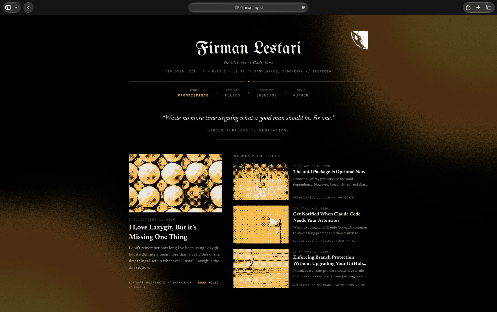

# fiirman.my.id 🌐

<p align="center">
  <strong>Personal portfolio, engineering dossier, and technical blog of Firman Justisio Lestari.</strong><br>
  Live at <a href="https://fiirman.my.id">fiirman.my.id</a>
</p>

<p align="center">
  <a href="https://fiirman.my.id"></a>
  <a href="https://tanstack.com/start"></a>
  <a href="https://react.dev/"></a>
  <a href="https://tailwindcss.com/"></a>
  <a href="https://bun.sh/"></a>
  <a href="https://workers.cloudflare.com/"></a>
</p>

---

## 🖼️ Preview



---

## 📖 About The Project

**fiirman.my.id** is a personal website and portfolio designed with an editorial, document-style aesthetic. It showcases software engineering projects, work history, technical competencies, and long-form engineering articles.

Instead of a generic template, this site embraces a tactile "engineering dossier" theme featuring clean typography, subtle paper textures, stamps, and interactive background shaders.

### ✨ Key Features

- **⚡ Modern Full-Stack SSR**: Built with TanStack Start and React 19 for type-safe routing and fast server-side rendering.
- **📰 Automated Article Sync**: A custom build script fetches articles from Medium RSS, converts them into clean local Markdown files, and generates a structured manifest with zero duplicates.
- **🎨 Editorial Document Design**: Monochromatic aesthetic with dark/light themes, ink accents, dithered visuals, and custom canvas shaders.
- **☁️ Edge Deployed**: Deployed to Cloudflare Workers with minimal latency around the globe.
- **⚡ Supercharged DX**: Powered by Bun and Vite 8 for near-instant build times and hot-reloading.

---

## 🛠️ Tech Stack

| Category | Technology | Purpose |
|---|---|---|
| **Framework & SSR** | [TanStack Start](https://tanstack.com/start) & [TanStack Router](https://tanstack.com/router) | Full-stack React framework with 100% type-safe routing |
| **UI Library** | [React 19](https://react.dev) | Component architecture & modern React primitives |
| **Styling** | [Tailwind CSS v4](https://tailwindcss.com) | Utility-first, high-performance CSS engine |
| **Visuals & Icons** | [Lucide React](https://lucide.dev) & [@paper-design/shaders-react](https://paper.design) | Minimalist iconography and interactive shader backgrounds |
| **Runtime & Package Manager** | [Bun](https://bun.sh) | Ultra-fast JavaScript runtime and package manager |
| **Bundler** | [Vite 8](https://vite.dev) | Modern frontend build tool |
| **Hosting & Edge** | [Cloudflare Workers](https://workers.cloudflare.com) via [Wrangler](https://developers.cloudflare.com/workers/wrangler/) | Serverless edge deployment |
| **Linter & Formatter** | [Biome](https://biomejs.dev) | Blazing fast code formatting and linting |
| **Content Pipeline** | `fast-xml-parser`, `marked`, `highlight.js` | Parses Medium RSS, converts to Markdown, and formats code blocks |

---

## 📁 Repository Structure

```text
fiirman.my.id/
├── content/              # Local markdown articles synced from Medium
├── public/               # Static assets (images, fonts, stamps, icons)
├── scripts/
│   └── sync-medium.ts    # Build-time RSS sync script
├── src/
│   ├── components/       # UI components (Header, Footer, Shaders, etc.)
│   ├── data/             # Bio, quotes, projects data, and article manifest
│   ├── routes/           # File-based routes for TanStack Router
│   ├── router.tsx        # Router configuration
│   └── styles.css        # Global Tailwind CSS definitions
├── vite.config.ts        # Vite, Cloudflare, and Tailwind plugins
└── wrangler.jsonc        # Cloudflare Workers configuration
```

---

## 🚀 Getting Started

### Prerequisites

Ensure you have **Bun** installed on your system. If not, install it via:

```bash
curl -fsSL https://bun.sh/install | bash
```

### Installation & Local Development

1. **Clone the repository:**
   ```bash
   git clone https://github.com/zeetec20/fiirman.my.id.git
   cd fiirman.my.id
   ```

2. **Install dependencies:**
   ```bash
   bun install
   ```

3. **Start the development server:**
   ```bash
   bun dev
   ```

4. Open [http://localhost:3000](http://localhost:3000) in your browser.

---

## 📜 Available Scripts

| Command | Description |
|---|---|
| `bun dev` | Starts the local dev server on port 3000 |
| `bun run sync:medium` | Crawls Medium RSS and syncs articles to `content/articles/` |
| `bun run build` | Syncs articles and builds the project for production |
| `bun run preview` | Previews the production build locally |
| `bun run check` | Formats and lints the codebase with Biome |
| `bun run typecheck` | Checks TypeScript types without emitting files |
| `bun run deploy` | Builds and deploys the application to Cloudflare Workers |

---

## 👤 Author

**Firman Justisio Lestari**
- Website: [fiirman.my.id](https://fiirman.my.id)
- GitHub: [@zeetec20](https://github.com/zeetec20)
- LinkedIn: [firmanlestari](https://www.linkedin.com/in/firmanlestari)
- Medium: [@firmanlestari](https://firmanlestari.medium.com)

---

## 📄 License

This project is open-source. Feel free to explore the code or use it as inspiration for your own portfolio!
